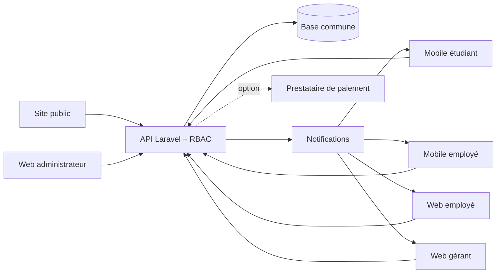

# Mon Miam Miam — interactions entre les applications et user stories

**Version de travail — 4 novembre 2026.** Ce document décrit le site public, les applications mobiles étudiant et employé, les espaces web employé, gérant et administrateur, puis leur future API commune. Les règles proposées doivent être validées avec l'équipe métier et backend.

## 1. Sources et état réel

- [Cahier des charges structuré](../../CAHIER_DES_CHARGES.md) : exigences ETU, EMP, GER, ADM, fidélité, livraison et paiement optionnel.
- [Architecture cible](../../ARCHITECTURE.md) et [index des contrats API](../../sprint-1/04-contrats-api/SPECIFICATIONS_API.md) : propositions à consolider.
- Implémentation : `mobile/src/App.js`, `mobile/src/EmployeeApp.js`, `frontend/src/features/public/`, `employee/`, `manager/`, `admin/` et `backend/routes/api.php`.

| Surface | Aujourd'hui | Cible |
| --- | --- | --- |
| Site public | Présentation et accès aux espaces web | Menu et publications réellement publiés |
| Mobile étudiant, Expo 58 | Panier, commandes et autres parcours en données locales | Compte, catalogue, commande, suivi, fidélité et réclamations synchronisés |
| Mobile employé, Expo 58 | Commandes, menu, réclamations et graphiques de démonstration, stockage local séparé | Même compte et mêmes ressources que le web employé |
| Web employé | Opérations en stockage navigateur | Interface alternative sur les mêmes ressources API |
| Web gérant | Supervision et maquettes de données | Validation, livraison, comptes et statistiques réels |
| Web admin | Écrans de gestion avec données de démonstration | Référentiel, politiques, publications et audit |
| Backend | Seul `GET /api/health` existe | Authentification, permissions, API métier et base |

Une commande mobile étudiant n'apparaît donc pas encore dans les espaces employés. Le bouton « Espace employé · démo » ne vérifie pas l'identité ni le rôle ; il sera remplacé par une connexion avec autorisation serveur.

## 2. Rôles et architecture cible

| Rôle | Écritures autorisées | Lectures autorisées |
| --- | --- | --- |
| Visiteur | Aucune donnée métier | Contenus publiés seulement |
| Étudiant | Son profil, ses commandes, ses réclamations | Ses propres opérations, menu et publications |
| Employé | Avancement des commandes, disponibilité temporaire, projet de réponse | Service courant, réclamations assignées, stats hebdomadaires |
| Gérant | Arbitrage, gestion des employés autorisée, affectation livraison | Supervision du restaurant |
| Administrateur | Menu de référence, comptes, politiques, publications | Rapports et audit |
| Livreur éventuel | Position/statut de ses courses, avec consentement | Ses livraisons seulement |

Le **serveur est la source de vérité** pour rôle, prix, commande, points, paiement et décision de réclamation. Web et mobile d'un employé utilisent le même `user_id` et le même périmètre de service. Chaque ressource mutable porte un identifiant stable, une version et un horodatage UTC.



## 3. Ressources partagées et règles

| Ressource | Champs essentiels | Origine et diffusion |
| --- | --- | --- |
| `users` | `id`, `role`, `status`, `permissions` | Admin/gérant autorisés créent le personnel ; API contrôle chaque requête |
| `menu_items` | `id`, `name`, `price`, `category`, `published`, `version` | Admin écrit ; public et étudiant voient la version publiée |
| `service_menu` | `menu_item_id`, `available`, `featured`, `service_date`, `version` | Employé change temporairement ; web/mobile/public se mettent à jour |
| `orders` + lignes | `id`, `student_id`, `service_type`, `total`, `status`, `version` | Étudiant crée ; employé traite ; gérant supervise ; prix des lignes figés |
| `deliveries` | `order_id`, `courier_id`, `status`, `location`, `updated_at` | Gérant/livreur alimentent ; étudiant voit uniquement sa course active |
| `complaints` | `id`, `order_id`, `student_id`, `status`, `draft`, `decision` | Étudiant ouvre ; employé propose ; gérant valide ; étudiant reçoit la réponse |
| `loyalty_transactions` / `referrals` | Identifiant, motif, points, commande liée | API attribue une seule fois et conserve un journal vérifiable |
| `publications` | Type, audience, date de début et fin | Admin publie ; public/mobile affichent selon l'audience |
| `statistics` | Période, périmètre, agrégats | API calcule depuis les opérations confirmées |

### États des commandes

Proposition : `Brouillon → Soumise → Reçue → En préparation → Prête`. Pour un retrait sur place : `Prête → Servie`. Pour la livraison : `Prête → Remise au livreur → En livraison → Livrée`. L'annulation dépendra de la politique de service. Le mobile employé actuel s'arrête à « Servie » ou « Remise au livreur » ; la livraison finale relève du livreur ou du gérant selon la décision à prendre.

Chaque changement transmet `order_id`, `next_status`, `expected_version` et une clé d'idempotence. L'API refuse les changements hors ordre ou sur version obsolète avec `409`, ceux sans droit avec `403` et renvoie la commande confirmée. Un double appui ne doit jamais créer deux événements.

### États des réclamations

Proposition : `Ouverte → En cours → Proposée au gérant → Approuvée/Rejetée → Résolue`. L'employé rédige et soumet, le gérant décide avec motif, puis le client voit uniquement la réponse approuvée. Toute compensation financière ou en points est une opération distincte, autorisée et auditée.

### Fraîcheur et conflits

Après chaque écriture, les clients remplacent l'état local par la réponse API. Une notification porte seulement `resource_id` et `version` ; les écrans relisent la ressource. Actualiser aussi à l'ouverture et au retour au premier plan. Sans réseau, afficher l'heure du dernier chargement et conserver les brouillons, mais **ne jamais afficher une commande, un paiement ou une réponse comme confirmés sans accusé serveur**. Si web et mobile employés modifient le même plat, la deuxième écriture sur ancienne version reçoit `409` et demande un rechargement. À la déconnexion, effacer jeton et cache sensible.

## 4. Interactions de bout en bout

### Commande, préparation et livraison

1. Admin publie un plat/prix. L'employé définit la disponibilité du service. Public et étudiant voient la même version publiée.
2. Étudiant valide le panier et choisit sur place avec heure, ou livraison avec adresse. L'API recontrôle disponibilité, horaires, total et adresse ; elle crée une seule commande.
3. La commande apparaît dans le web et le mobile employé ainsi que dans la supervision gérant. Un employé avance les étapes ; étudiant et gérant voient les statuts confirmés.
4. L'employé confirme « Servie » ou « Remise au livreur ». Le gérant/livreur suit et confirme la livraison ; la carte étudiant montre seulement une position réelle, datée et autorisée.
5. La vente et les points ne sont comptabilisés qu'après les événements éligibles définis par la politique approuvée.

### Plat épuisé

L'employé marque le plat indisponible sur mobile ou web. L'autre écran employé et le catalogue étudiant voient le changement. Si le plat est déjà au panier, la confirmation est refusée avec l'article concerné. Le prix reste sous contrôle admin. La durée d'une indisponibilité temporaire est à valider.

### Réclamation

Étudiant dépose une réclamation sur sa commande. Employé prend en charge et soumet une réponse depuis mobile ou web. Gérant approuve, rejette ou demande une correction. Étudiant reçoit le statut puis la réponse approuvée ; admin peut auditer l'historique. Aucun brouillon employé n'est visible par l'étudiant.

### Promotions, jeu, fidélité et paiement

Admin publie une promotion, un événement ou un jeu avec audience et dates. Site public et mobile étudiant affichent les contenus qui leur sont destinés. L'API attribue points et récompenses avec un journal anti-doublon. Le paiement à la caisse/livraison peut être indiqué « à régler » puis confirmé par le personnel autorisé. Visa, Mastercard, Mobile Money et crypto restent **visuels et désactivés** jusqu'au choix d'un prestataire ; si ajoutés, seul un webhook vérifié côté serveur confirme le règlement.

La [recherche sur e-COM EasyPay](../08-fidelite-paiement/RECHERCHE_ECOM_EASYPAY.md) confirme seulement que le fournisseur annonce Visa, Mastercard et Mobile Money. La prise en charge de notre devise et l'accès au contrat sandbox restent à confirmer ; aucune prise en charge des cryptomonnaies n'est annoncée sur les pages consultées.

## 5. User stories et critères d'acceptation

Priorités : **P0** noyau d'une commande réelle ; **P1** périmètre métier ; **P2** extension ou bonus. Les ID servent au suivi des tickets et à la recette.

### Public et étudiant

| ID | Prio | En tant que… je veux… | Critères d'acceptation |
| --- | --- | --- | --- |
| PUB-01 | P1 | Visiteur, découvrir menu, offres et accès aux applications. | Contenus publiés/non expirés ; prix API ; parcours de connexion clair. |
| ETU-01 | P0 | Étudiant, créer une session et retrouver mes données sur un autre téléphone. | Session révocable ; commande d'autrui inaccessible ; profil rechargé depuis API. |
| ETU-02 | P0 | Voir les plats et disponibilités actuelles. | Recherche/catégories ; plat épuisé non commandable ; dernière actualisation indiquée. |
| ETU-03 | P0 | Commander sur place ou en livraison. | Heure ou adresse obligatoire ; prix recalculé serveur ; double appui sans doublon. |
| ETU-04 | P0 | Suivre commande et éventuelle livraison. | États confirmés ; position réellement reçue et datée ; aucune carte fictive présentée comme réelle. |
| ETU-05 | P1 | Déposer et suivre ma réclamation. | Commande liée à mon compte ; réponse seulement après approbation gérant. |
| ETU-06 | P1 | Consulter points et parrainage. | Solde issu du journal ; gain unique après commande éligible ; correction traçable. |
| ETU-07 | P1 | Voir promotions, événements et jeux. | Dates et audience respectées ; participation contrôlée par l'API. |

### Employé : même fonctionnement mobile et web

| ID | Prio | En tant que… je veux… | Critères d'acceptation |
| --- | --- | --- | --- |
| EMP-01 | P0 | Employé, voir les mêmes commandes du service sur téléphone et web. | Même compte/rôle ; filtres et recherche ; mêmes versions après actualisation. |
| EMP-02 | P0 | Lire détails, quantités, mode et heure pour préparer. | Données serveur ; commande hors service refusée ; statut clairement visible. |
| EMP-03 | P0 | Avancer les commandes étape par étape. | Transitions légales ; auteur/date ; conflit `409` ; autres apps actualisées. |
| EMP-04 | P1 | Déclarer un plat épuisé et choisir le plat du jour. | Web/mobile cohérents ; prix non modifiable ; un seul plat du jour actif. |
| EMP-05 | P1 | Prendre une réclamation et proposer une réponse. | Réponse 1–500 caractères ; statut « proposée » ; aucun envoi direct au client. |
| EMP-06 | P1 | Consulter les statistiques hebdomadaires. | Période explicite ; totaux API ; aucune donnée fictive dans les résultats réels. |

### Gérant, administrateur et services

| ID | Prio | En tant que… je veux… | Critères d'acceptation |
| --- | --- | --- | --- |
| GER-01 | P0 | Gérant, superviser commandes et livraison. | Statuts cohérents ; carte limitée aux courses actives et position datée. |
| GER-02 | P1 | Valider/refuser les réponses proposées. | Décision et motif tracés ; client notifié uniquement après approbation. |
| GER-03 | P1 | Créer ou désactiver des employés autorisés. | Permissions limitées ; désactivation révoque les sessions. |
| GER-04 | P1 | Voir ventes, commandes, fidélité et parrainage. | Filtres de période ; agrégats issus des opérations confirmées. |
| ADM-01 | P0 | Admin, maintenir le menu de référence. | CRUD autorisé ; prix historisés ; prix des commandes passées inchangés. |
| ADM-02 | P1 | Gérer comptes, horaires et politiques. | Validation, date d'effet et journal d'audit. |
| ADM-03 | P1 | Publier promotions, événements et jeux. | Brouillon invisible ; date/audience contrôlées ; expiration appliquée. |
| ADM-04 | P1 | Auditer réclamations et statistiques. | Périmètre RBAC ; historique et métriques reproductibles. |
| API-01 | P0 | Système, protéger toutes les données par rôle et propriétaire. | `401` sans session, `403` sans droit ; aucun rôle accepté du client. |
| API-02 | P0 | Système, éviter doubles commandes et transitions. | Idempotence, version, journal d'événements. |
| API-03 | P1 | Système, tenir les écrans synchronisés après une action. | Notification puis relecture ; reprise après coupure ; versions ordonnées. |
| PAY-01 | P2 | Étudiant, payer en ligne si cette option est activée. | Prestataire/sandbox validés ; secret absent de l'app ; webhook vérifié. |

## 6. Contrats API à préparer — propositions non implémentées

| Ressource | Usage | Écriture autorisée |
| --- | --- | --- |
| `/api/auth/*`, `/api/me` | Session et profil | Titulaire / administration selon opération |
| `/api/menu-items`, `/api/service-menu` | Catalogue et disponibilités | Admin / employé respectivement |
| `/api/orders`, `/api/orders/{id}` | Création, liste, détail et transitions | Étudiant propriétaire / employé de service |
| `/api/deliveries/{id}` | Affectation et suivi | Gérant/livreur autorisé |
| `/api/complaints`, `/api/complaints/{id}` | Ouverture, brouillon, décision | Étudiant / employé / gérant selon étape |
| `/api/loyalty`, `/api/referrals` | Journal et code | Services serveur / admin pour règles |
| `/api/publications`, `/api/games` | Contenus et participation | Admin / étudiant selon étape |
| `/api/stats/*` | Agrégats par période | Calcul serveur, lecture selon rôle |
| `/api/payments/*` | Bonus de règlement en ligne | Serveur et prestataire uniquement |

Exemple de requête de transition à définir dans OpenAPI :

```json
{
  "next_status": "en_preparation",
  "expected_version": 7,
  "idempotency_key": "f9550344-17cb-45f9-9079-bdb153418c9b"
}
```

Réponse : commande complète avec `version: 8`, `updated_at` et `updated_by`. Erreur commune à définir : `code`, `message`, `field_errors`, `request_id`. Les chemins et champs de ce tableau sont des **propositions**, pas des routes disponibles.

## 7. Sécurité et recette d'intégration

- Jeton mobile en stockage sécurisé, jamais dans AsyncStorage ; TLS ; aucune clé de paiement dans le dépôt. Limiter l'exposition d'adresse, téléphone et géolocalisation.
- Position du livreur consentie, limitée à la course, avec fraîcheur affichée. Après la course, arrêt du partage et conservation selon une durée validée.
- Réponses, compensations, points et règlements audités avec auteur, motif et date. Un gérant ne voit que son établissement si le multi-restaurant est activé.
- **Recette A :** étudiant crée une commande → elle apparaît sur mobile et web employé → préparation mobile → actualisation web, gérant et étudiant → remise sans doublon.
- **Recette B :** plat épuisé sur web employé → mobile employé et catalogue étudiant actualisés → panier refusé précisément → réactivation mobile visible sur web.
- **Recette C :** réclamation étudiant → proposition mobile employé → approbation gérant → réponse étudiant ; vérifier son invisibilité avant approbation.
- **Recette D :** réseau coupé, requête répétée, version périmée, session révoquée et accès à la commande d'autrui ; vérifier refus et messages.
- **Recette E :** statistiques et points recalculés depuis les commandes confirmées ; aucun point pour paiement en attente ou opération non éligible.

## 8. Ordre d'intégration et décisions ouvertes

1. Valider modèle de données, statuts, matrice de permissions et contrat OpenAPI. Aligner les identifiants des catalogues web et mobile.
2. Livrer auth/RBAC, menu commun et commandes. Remplacer les jeux locaux sur chaque interface.
3. Connecter mobile et web employé au même service, puis réclamations, livraison et statistiques.
4. Connecter publications, fidélité, parrainage et jeux ; exécuter la recette entre applications.
5. Ajouter le paiement en ligne uniquement si le bonus est retenu et cadré.

À trancher : annulation, heure limite et zone de livraison ; acteur qui confirme « livrée » ; fréquence et durée de géolocalisation ; expiration des disponibilités temporaires ; éligibilité des points et parrainages ; devise ; prestataire éventuel ; canal de notification ; accès multi-restaurant. Les exemples chiffrés du cahier ne constituent pas des règles validées.
